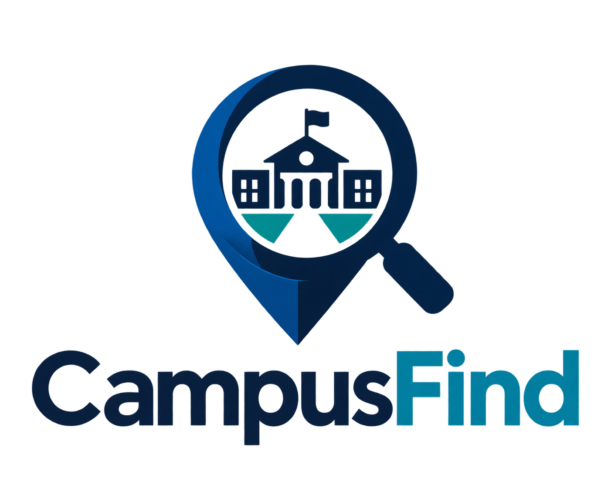

# CampusFind

**A smarter way to reconnect lost items with their owners on campus.**

CampusFind is a web-based lost-and-found application built for the **2026 Congressional App Challenge**. It helps students report lost or found belongings, discover possible matches, and submit claims for review.

**[Try the Live Demo](https://campusfind-xb6qcs32m7khxmmfzbmcq3.streamlit.app/)**



## The Problem

Lost items at school can be difficult to recover when information is scattered, incomplete, or hard to search. Students who lose belongings may not know what has already been found, while students who find items may not know how to reach their owners.

## The Solution

CampusFind provides one place to report, search for, and match lost and found items. Instead of relying only on exact search results, it compares reported details and explains why a found item might be a match.

## Features

- **Lost and Found reports:** Enter an item name, category, color, location, date, and description. Found reports can include a photo.
- **Search and filters:** Browse reports by search terms, report type, category, and status.
- **Explainable matching:** View up to three possible matches, each with a score and reasons for the score.
- **Item claims:** Submit a claim with contact information; the claim is marked as pending review.
- **Admin tools:** Password-protected tools for reviewing claims, managing reports and locations, and marking items as returned.

## How Matching Works

CampusFind uses a **rule-based weighted matching algorithm**, not a machine-learning model. It compares a Lost report with eligible Found reports using the following criteria:

| Matching criterion | Maximum points |
| --- | ---: |
| Category | 30 |
| Color | 20 |
| Location | 20 |
| Date proximity | 15 |
| Item-name similarity | 15 |
| **Total** | **100** |

Before a match is suggested, the algorithm checks that:

1. The Lost and Found reports are both **Open**.
2. The item was found **on or after** the date it was reported lost.
3. The item names share a meaningful normalized token, with a limited set of aliases (for example, *AirPods* and *earbuds*).
4. The weighted score is **at least 50/100**.

The app displays the **top three** eligible matches and explanations such as matching category, color, location, or date. **A matching score measures similarity, not the probability of ownership.** Claims still require human review.

## Technology

- **Python** — application logic
- **Streamlit** — interactive web interface
- **SQLite** — reports, claims, and locations in the current prototype
- **Python `difflib.SequenceMatcher`** — part of the item-name similarity calculation
- **Streamlit Community Cloud** — live demo hosting

## Running Locally

1. Clone the repository:

   ```bash
   git clone https://github.com/NotoriOh/CampusFind.git
   cd CampusFind
   ```

2. Install the dependencies (a virtual environment is recommended):

   ```bash
   python -m pip install -r requirements.txt
   ```

3. For administrator access, create a local file at `.streamlit/secrets.toml`:

   ```toml
   admin_password = "REPLACE_WITH_YOUR_OWN_STRONG_PASSWORD"
   ```

   **Never commit `secrets.toml` or a real administrator password to GitHub.**

4. Start the app:

   ```bash
   python -m streamlit run app.py
   ```

5. Open the local URL shown in the terminal.

## Demo Walkthrough

1. Open **Browse Reports** to explore sample Lost and Found items, if demo data has been initialized.
2. Open a Lost report and review **Possible Matches**, including the score explanations.
3. Select **Claim This Item** on an available Found report and submit **fictional test information**.
4. An administrator can review the pending claim and, after verification, mark the item as **Returned**.

## Current Limitations and Next Steps

**This is a prototype and public demo, not a production lost-and-found system.** Reports, claims, and uploaded photos are currently stored in local files on Streamlit Community Cloud and **may be lost when the app restarts or redeploys**. Sample reports can be initialized for demonstrations, but this does **not** recover real user submissions. Please do not enter real personal contact information.

A planned post-challenge improvement is to migrate to **Supabase PostgreSQL and Storage** for persistent data and photos. Further work may include improving matching accuracy and strengthening privacy and ownership verification.

---

*Developed for the 2026 Congressional App Challenge.*
